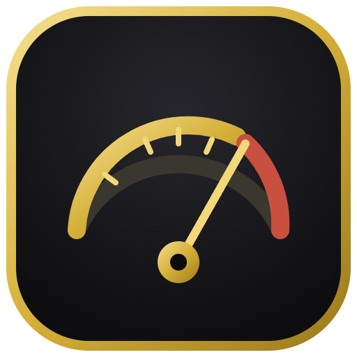
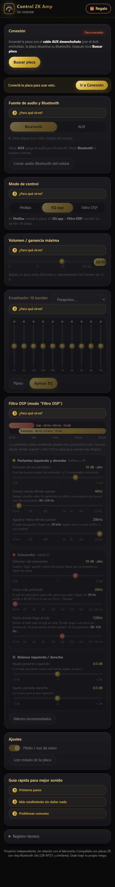

# Control ZK Amp 🎛️

App **independiente** para controlar por Bluetooth las placas amplificadoras **ZK**
con chip Bluetooth **JieLi** (ZK-MT21 y similares), desde **Android** y **Windows**.

> Proyecto independiente, **sin relación con el fabricante**. "Wuzhi", "ZK" y
> "JieLi" son marcas de sus respectivos dueños. Esta app no incluye ni distribuye
> código del fabricante: se escribió desde cero para ser compatible con sus placas.

<p align="center">
  <br>
  
</p>

---

## ⚠️ Importante: ¿tu placa admite control por app?

No todas las placas ZK-MT21 tienen control por app. **Muchas unidades solo hacen
audio** por Bluetooth y se ajustan únicamente con las perillas físicas; en esas,
**ninguna app** (ni esta ni la oficial) puede cambiar el sonido.

Cómo saberlo: al buscar con la app, tu placa tiene que aparecer como un equipo de
**control** (BLE). Si solo aparece como **"solo audio"**, esa placa no admite
control por app. (La app te lo avisa en pantalla.)

---

## ✨ Qué controla (en placas compatibles)

- **Ecualizador de 10 bandas** (±12 dB) con preajustes (graves, voces, rock, fiesta…).
- **Filtro DSP / crossover**: reparto de frecuencias entre parlantes y subwoofer,
  con un mapa visual de qué toca cada salida.
- **Volumen / ganancia máxima** y **balance** izquierda/derecha.
- **Fuente de audio**: Bluetooth, AUX (y USB / tarjeta de sonido en placas que las tengan).
- **Pitido / voz de aviso** on/off.
- **Leer el estado** actual de la placa.
- Ayuda "¿Para qué sirve?" en cada sección y guía de sonido.
- Botón de **regalo** opcional para el creador (ver abajo).

Interfaz oscura con detalles en dorado e ícono de vúmetro. La **misma interfaz**
corre en Android y en Windows.

---

## 📥 Instalar (usuarios)

Descargá desde la sección **[Releases](../../releases)**:

- **Android**: `ControlZKAmp-x.y.z.apk` → pasalo al celular y abrilo. Android pedirá
  permitir "instalar apps de origen desconocido" y, al usarla, el permiso de
  **Dispositivos cercanos** (necesario para encontrar la placa).
- **Windows**: `ControlZKAmp-x.y.z.exe` → portable, se abre con doble clic, sin
  instalar. La PC necesita Bluetooth. Si Windows muestra "protegió su PC", tocá
  **Más información → Ejecutar de todas formas** (la app no tiene firma digital paga).

### Cómo conectar

1. Encendé la placa (con el cable AUX desenchufado).
2. Abrí la app y tocá **Buscar placa**.
3. Elegí tu placa en la lista (las de **control** aparecen resaltadas; las de
   **solo audio** se marcan como tales).

---

## 🛠️ Compilar desde el código (desarrolladores)

Estructura:

- `app/` — interfaz compartida (HTML + CSS + JavaScript). Es el corazón de la app.
- `windows/` — envoltorio **Electron** para el `.exe`.
- `android/` — actividad nativa (WebView + puente Bluetooth LE) y script de compilado.

### Windows

```bash
cd windows
npm install
npm run dist      # genera dist/ControlZKAmp-x.y.z.exe (portable)
```

### Android

Compilación sin Gradle, con el SDK de Android (`aapt2`, `d8`, `zipalign`,
`apksigner`) y un JDK 17+:

```bash
cd android
sh build.sh       # genera out/ControlZKAmp-x.y.z.apk (firmado)
```

> La clave de firma (`release.keystore`) **no se incluye** por seguridad; el script
> genera una automáticamente la primera vez. Para publicar tus propias versiones,
> usá tu propia clave y guardala.

---

## 🎁 Botón de regalo (donaciones)

La app trae un botón **🎁 Regalo** opcional. El enlace se configura en
[`app/js/config.js`](app/js/config.js):

```js
window.APP_CONFIG = {
  donateUrl: '',   // poné aquí tu enlace, por ejemplo https://paypal.me/tuusuario
};
```

Mientras esté vacío, el botón muestra "próximamente". Recomendado: PayPal.Me (mundial)
y/o Cafecito (Argentina/Uruguay).

---

## 🔍 Notas técnicas

- Las placas ZK con control usan el protocolo **RCSP** de JieLi sobre BLE
  (servicio `0xAE00`). El chip exige una **autenticación** antes de aceptar comandos.
- Ese handshake usa el algoritmo **E1 (SAFER+)** del estándar Bluetooth con una clave
  fija de JieLi. Está **reimplementado desde cero** en
  [`app/js/jl-auth.js`](app/js/jl-auth.js), y verificado contra la librería original
  (coincide en todos los vectores de prueba).
- Los comandos de EQ, DSP, volumen y fuente se derivaron por interoperabilidad, no se
  copió código del fabricante.

## 📌 Estado

- ✅ Autenticación verificada contra la app oficial.
- ✅ Probada en emulador de Android y en Windows.
- ⚠️ **Aún no probada contra una placa real con control por app.** Si la probás con
  una, se agradecen reportes (abrí un *issue*).

## ⚖️ Aviso

Software libre, **úsalo bajo tu propio riesgo**. No está afiliado ni respaldado por
el fabricante de las placas. Licencia [MIT](LICENSE).
